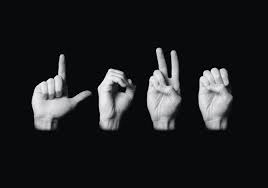

# ✋ Sign_Recognition
### Real-Time Hand Sign Recognition | Computer Vision | Deep Learning



[]()
[]()
[]()
[]()

**Sign_Recognition** is a computer vision and deep learning project designed to recognize hand gestures using image processing and trained neural network models.

The system focuses on American Sign Language (ASL) alphabet recognition, enabling users to classify hand signs through visual input and experiment with real-time gesture recognition.

It provides a foundation for developing AI-powered accessibility applications, human-computer interaction systems, and gesture-based interfaces.

---

## ✨ Key Features

### 🤚 1. Hand Gesture Recognition
- Recognizes multiple hand gestures.
- Classifies hand signs using a trained deep learning model.
- Supports ASL alphabet recognition.

### 🎥 2. Real-Time Recognition
- Supports webcam-based input.
- Processes video frames using OpenCV.
- Displays predicted hand gestures during inference.

### 🧠 3. Deep Learning-Based Classification
- Uses TensorFlow / Keras.
- Applies image preprocessing before classification.
- Uses a trained model to predict gesture categories.

### 💻 4. Cross-Platform Compatibility
- Python-based implementation.
- Designed for Windows, macOS, and Linux.
- Supports compatible webcam devices.

### 🔄 5. Extensible Architecture
- Can be extended with additional gesture classes.
- Supports further model training and experimentation.
- Provides a starting point for accessibility-oriented applications.

---

## 🏗️ System Architecture

```text
           Webcam / Image Input
                    |
                    v
             Frame Capture
                    |
                    v
            Image Preprocessing
                    |
                    v
          Deep Learning Model
             (TensorFlow)
                    |
                    v
          Hand Sign Classification
                    |
                    v
             Predicted Sign
                    |
                    v
           OpenCV Visualization
                    |
                    v
             Output Display
```

---

## 📊 Dataset

### ASL Alphabet Dataset

The project uses the **ASL Alphabet Dataset** published by grassknoted on Kaggle.

Dataset information:
- Total Training Images: 87,000.
- Image Resolution: 200 × 200 pixels.
- Total Classes: 29.
- Alphabet Classes: A–Z.
- Additional Classes: SPACE, DELETE, NOTHING.

**Dataset Source:**

[ASL Alphabet – Kaggle](https://www.kaggle.com/datasets/grassknoted/asl-alphabet)

**Original Dataset DOI:**

https://doi.org/10.34740/KAGGLE/DSV/29550

### Dataset Attribution

The ASL Alphabet dataset was published by its original creator, grassknoted.

All dataset ownership and associated rights remain with the original creator and are subject to the dataset's published license.

Dataset licensing must be respected independently of this repository's source code license.

---

## 🛠️ Technologies & Tools

| Technology | Purpose |
|---|---|
| Python | Programming Language |
| OpenCV | Image Processing and Computer Vision |
| TensorFlow | Deep Learning Framework |
| Keras | Neural Network Development |
| NumPy | Numerical Computing |

---

## 📦 Installation

### 1. Clone the Repository

```bash
git clone https://github.com/Mahmoud3301/Sign_recognition.git

cd Sign_recognition
```

### 2. Install Dependencies

```bash
pip install -r requirements.txt
```

### 3. Run the Application

Run the main Python application:

```bash
python main.py
```

**Note:** The actual entry-point filename and required model weights should match the files included in the repository.

---

## 🚀 Future Improvements

- Expand recognition capabilities beyond alphabet gestures.
- Introduce dynamic gesture recognition for signs involving movement.
- Integrate speech-to-text and text-to-speech capabilities.
- Develop web and mobile application interfaces.
- Improve model performance under different lighting and background conditions.
- Build an accessibility-focused communication assistant.

---

## ⚠️ Limitations & Responsible Use

- This project primarily focuses on static ASL alphabet gesture recognition.
- Recognizing alphabet gestures does not constitute complete American Sign Language understanding.
- Full sign language interpretation requires additional linguistic, temporal, and contextual information.
- Recognition performance depends on image quality, lighting, hand positioning, and training data.
- The system should not be considered a replacement for qualified sign language interpreters.

---

## 📜 Licensing & Intellectual Property

### Original Project Source Code

Copyright (c) 2026 Mahmoud Saeed Mansour.

The original source code authored for this project is licensed under the **MIT License**.

You are permitted to:
- Use the original source code commercially or privately.
- Modify and adapt the original implementation.
- Distribute original or modified versions.
- Include the original code in other projects and applications.

All uses must comply with the MIT License conditions, including preservation of applicable copyright and license notices.

### Third-Party Components & Resources

| Component | Original Source | License |
|---|---|---|
| TensorFlow | [TensorFlow](https://github.com/tensorflow/tensorflow) | Apache 2.0 |
| OpenCV 4.5.0+ | [OpenCV](https://github.com/opencv/opencv) | Apache 2.0 |
| ASL Alphabet Dataset | [grassknoted – Kaggle](https://www.kaggle.com/datasets/grassknoted/asl-alphabet) | GPL-2 (as listed on Kaggle) |
| NumPy | [NumPy](https://github.com/numpy/numpy) | BSD 3-Clause |

### Important Licensing Notice

- The MIT License applies to the original source code authored for this project.
- Third-party libraries remain subject to their respective licenses.
- The ASL Alphabet dataset is separately licensed under the terms displayed on its original Kaggle page.
- The repository's MIT License does not replace, override, or grant additional rights to the dataset.
- Users must comply with the dataset's licensing and attribution requirements when downloading, using, or redistributing it.
- No ownership of third-party datasets, libraries, or external resources is claimed by this project.

---

## 👨‍💻 Developed By

**Mahmoud Saeed Mansour**

AI & Machine Learning Engineer | Computer Vision | Deep Learning | NLP | RAG

- GitHub: [@Mahmoud3301](https://github.com/Mahmoud3301)
- LinkedIn: [Mahmoud Saeed Mansour](https://www.linkedin.com/in/mahmoud-saeed-928623252/)
- Portfolio: [Personal Portfolio](https://mahmoud3301.github.io/mypersonalweb/)

---

## © Copyright Notice

© 2026 Mahmoud Saeed Mansour.

All rights to the original source code contributions are reserved under the MIT License.

Third-party components, datasets, and external resources remain the property of their respective authors and owners and are governed by their applicable licenses.


